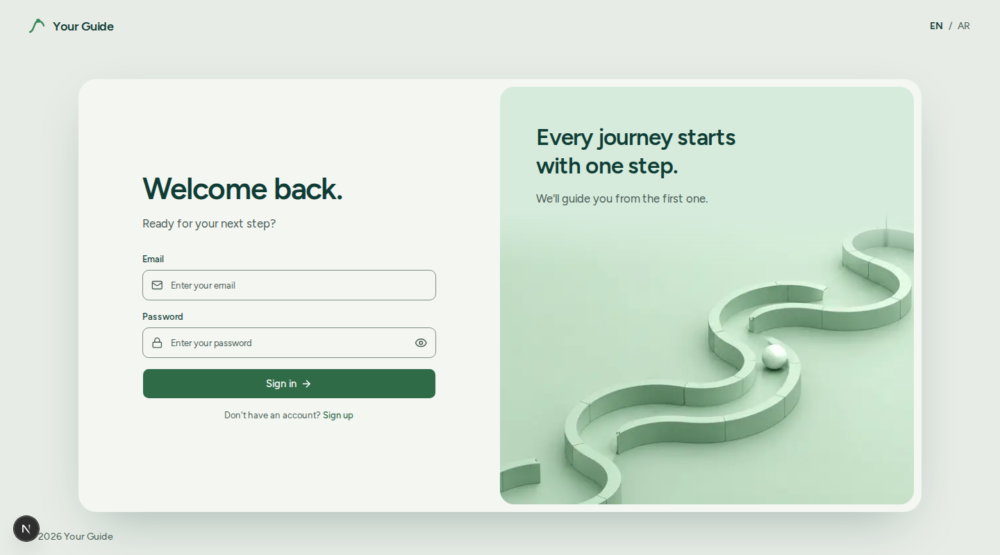
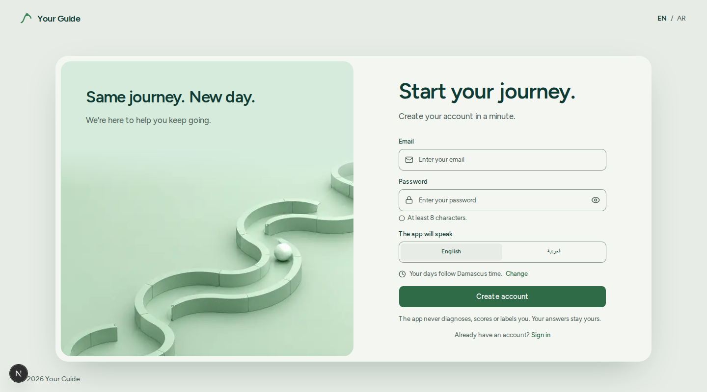
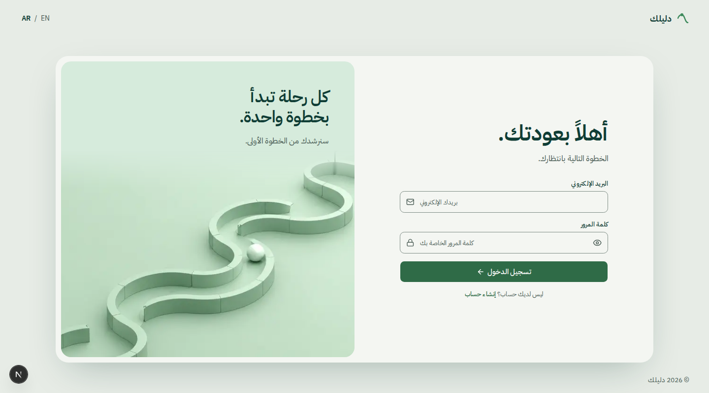
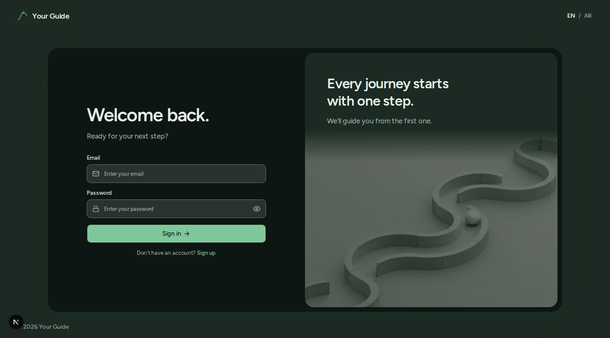
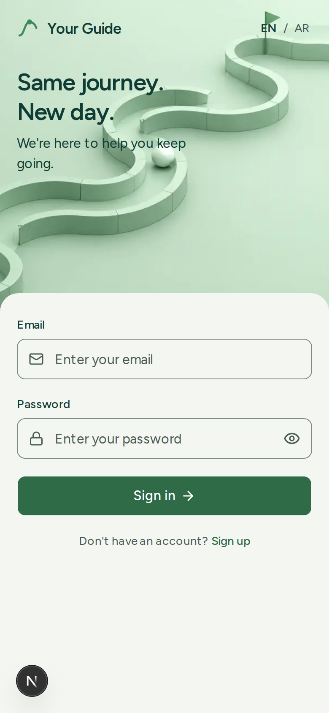
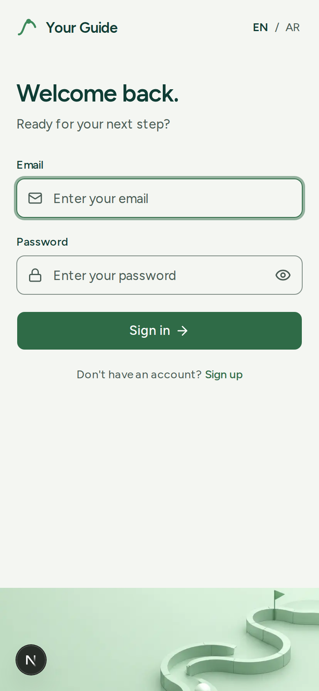

# Your Guide · Design reference

**The approved sign-in screen (2026-10-28) is the reference for every page.** Same colours, same type, same feeling. Before designing a page, open the screenshots below and match them. The code of the reference is `src/features/auth/components/auth-shell.tsx`; the colour tokens are in `src/app/globals.css`.

| Laptop, sign in | Laptop, sign up |
| --- | --- |
|  |  |

| Arabic (mirrored) | Dark |
| --- | --- |
|  |  |

| Phone, first view | Phone, after the first tap on a field |
| --- | --- |
|  |  |

## 1. The feeling

Calm, clear, hopeful. One path, one next step. A quiet sage ground, one large rounded card that holds the work, generous space, big friendly headings, and the journey picture (a winding path, a ball, a flag) as the only illustration. Nothing shouts. One movement at a time, smooth and slow enough to follow.

## 2. Colour

Use the tokens, never hex values in components (`bg-background`, `text-foreground`, `bg-primary`, `text-muted-foreground`, `border-input`, `bg-muted`, `bg-illustration`).

| Role | Token | Light | Dark | Used for |
| --- | --- | --- | --- | --- |
| Page ground (laptop) | `muted` | #E7ECE6 | #1D2A23 | The sage area around the card |
| Card / page | `background` | #F4F6F2 | #0E1613 | The card, phone pages |
| Surface | `card` | #FFFFFF | #152019 | Raised surfaces inside a card |
| Headings and text | `foreground` | #0F3D35 | #E6EFE9 | Deep green ink |
| Secondary text | `muted-foreground` | #4A5C55 | #A9BAB0 | Intros, hints |
| Quiet text | `subtle` | #5A6A64 | #86978E | Small labels |
| Action | `primary` | #2F6B47 | #7FC79A | Buttons, links, focus ring, the one accent |
| On action | `primary-foreground` | #FFFFFF | #0B2417 | Text on buttons |
| Soft accent | `accent` / `accent-foreground` | #DCEBE0 / #245437 | #1E3A2A / #A8DDBA | Notices, selected states |
| Illustration | `illustration` | #D6EBDC | #1B2A22 | Behind the picture, the mint tile |
| Lines | `border` | #D5DDD6 | #2A3A31 | Dividers |
| Control edges | `input` | #7E8C85 | #66786E | Field borders (3:1) |
| The struggle button | `ink` / `ink-foreground` | #0F3D35 / #F4F6F2 | #E6EFE9 / #0E1613 | "I'm struggling" only |
| Done | `success-ink` | #1F6B3E | #7FD09D | Done checks only |
| Destructive, errors | `destructive` | #AB413E | #ED8C84 | Errors and delete only |

Rules: one green for every action; the struggle button in deep green ink; red only for errors and deleting; text 4.5:1 or better, control edges 3:1 or better in both themes (checked when the palette was made).

## 3. Type

- **Latin:** Figtree (400, 500, 600, 700). **Arabic:** IBM Plex Sans Arabic. **Numbers and small labels:** IBM Plex Mono when alignment matters.
- **Page heading:** 48px (`text-5xl`) on a laptop, 30px (`text-3xl`) on a phone, semibold, tight tracking, `leading-tight`.
- **Tile / hero message:** 36px (`text-4xl`) on a laptop, 28px on a phone, semibold.
- **Intro under a heading:** 18px (`text-lg`) on a laptop, 16px on a phone, `text-muted-foreground`.
- **Body and fields:** 16px. **Labels:** 14px medium. **Hints and footers:** 14px.
- Copy is short, warm and never judging ("Welcome back.", "Ready for your next step?"). Arabic avoids gendered imperatives.

## 4. Shape, space and depth

- **The card:** radius 28px, `bg-background`, shadow `0 30px 80px -30px rgb(15 61 53 / 0.35)`, up to 1320px wide, centred on the sage ground. On windows up to 820px tall it scales to 92%, under 700px to 82%, so it always fits.
- **The inset tile:** radius 22px, 12px inside the card's edge, `bg-illustration`, the picture in its lower part fading in at the top, the message top-start over plain mint.
- **Inside the card:** 64px side padding and 48px top and bottom on a laptop; 20px on a phone. Form column up to 460px.
- **Controls:** inputs 48px tall, radius 10px, a leading icon (mail, lock) and a placeholder; primary buttons 48px, full width in forms, radius 10px, label 16px with an arrow when it moves forward.
- **Phone sheet:** radius 24px on the top corners, overlapping the hero by 24px.
- **Above the card:** the logo and name at the start, EN / AR at the end; the year at the bottom.

## 5. Motion

- One movement at a time: a glide of 700ms with `cubic-bezier(0.77, 0, 0.18, 1)`. Phones use 500ms.
- Messages crossfade: the old one leaves in 150ms, the new one arrives after 300ms.
- Pictures move a little the other way (parallax), never more than a few percent.
- Reduced motion: every transition is removed; states switch instantly.

## 6. Imagery

- One illustration family: the journey picture (`public/images/auth-journey.png`) and the logo (`public/images/logo.svg`, the bending path with a point on it, one green for both themes).
- No stock photos, no emoji, no gradient washes. A fade is allowed only to blend the picture into its own mint.
- In dark mode the picture is dimmed with a filter.

## 7. Direction and access

- Logical spacing (`ps-`, `ms-`, `start-`, `end-`) and the `rtl:` variant everywhere; Arabic mirrors layout, movement and the picture. Passwords and emails stay left to right.
- Real buttons, links, labels and `inert` on anything hidden. Touch targets 44px or more. Focus ring in the action green.

## 8. Building a new page from this reference

1. Start on the sage ground with the logo row above, the work in one large rounded card.
2. Use the mint tile with the journey picture where a page needs a moment of encouragement.
3. Headings large and calm, one primary green action per screen, everything else quiet.
4. Show the design (screenshots or the running page) and get the owner's OK before committing.

## 9. Known follow-ups

- In dark mode the tile shows a visible edge where the dimmed picture meets the plain area above the message. Needs a matching dark tone or a softer fade (owner to approve).
- In the sign-up state the tile's picture shifts and the flag can leave the frame; a smaller shift would keep it.
- The picture looks like an Untitled UI demo image: confirm the licence before launch.
